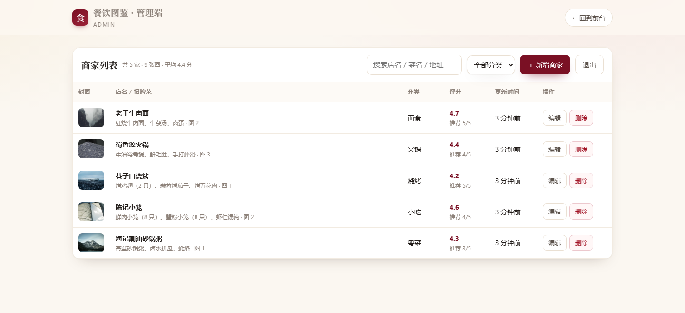
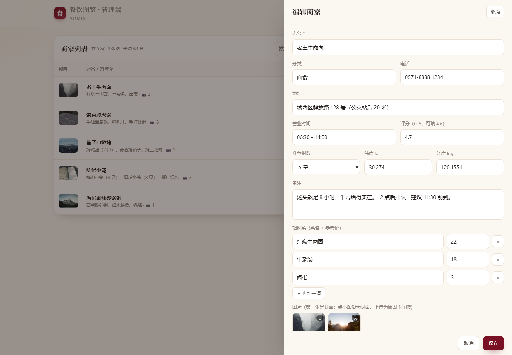

# 餐饮图鉴 · Web 版（Node + MySQL）

把原来「小程序 + db.json」那套，换成 **浏览器直接打开的网页 + MySQL 存储**：
前台是给朋友看的图鉴，管理端是给自己用的后台，图片仍然是服务器上的原图，不压缩。

> 现有小程序版一行没动，两套可以同时跑、共用同一批图片目录（把 `server/uploads`
> 拷过来即可），需要的话再用 `scripts/import-json.js` 把旧数据搬进 MySQL。

---

## 界面预览

前台（`/`）：统计、搜索、分类、卡片图鉴


管理端（`/admin`）：口令登录后的商家列表



编辑抽屉：菜品逐行增删、图片上传/设为封面



> 截图里的封面占位纹样是图片没加载出来时的兜底样式（演示数据用的是 picsum 外链，内网环境会显示成店名首字）。

---

## 一、先把现状说清楚（改动的理由）

| | 原版 `server/server.js` | 本版 `web-mysql/` |
|---|---|---|
| 数据存储 | `data/db.json` 整个文件读进内存、改完整体回写 | InnoDB 三张表，事务写入 |
| 并发 | 两人同时改会互相覆盖，进程崩了可能丢最后一次写 | 行级锁 + 事务，天然支持多人同时改 |
| 查询 | 全量遍历 + `indexOf` 过滤 | `WHERE` + 索引，分页 `LIMIT`，数据上万条也不卡 |
| 图片 | 数组里塞 URL，删图要遍历所有商家 | `shop_images` 独立表，可单独增删排序，外键级联清理 |
| 招牌菜 | 内嵌 JSON 数组，没法按菜名统计 | `shop_dishes` 独立表，可以按菜查店 |
| 备份 | 拷 `db.json` | `mysqldump` 一条命令，可定时、可异地 |
| 要不要装东西 | 零依赖，`node server.js` 就跑 | 需要 MySQL + `npm install`（只有一个包 `mysql2`） |

结论：数据量小、只有两三个人用，JSON 版够用；一旦要多人同时编辑、要按菜名搜索、
要长期备份，MySQL 版更稳。页面本身也从「卡片列个表」升级成了可搜索、可筛选、
带详情画廊的图鉴页。

---

## 二、目录结构

```
web-mysql/
├── server.js              HTTP 服务：REST API + 静态页 + 图片上传
├── db.js                  MySQL 连接池与全部 SQL（唯一需要看 SQL 的地方）
├── package.json           只有 mysql2 一个依赖
├── .env.example           复制成 .env 再改
├── sql/
│   ├── schema.sql         建库建表 + 视图（可重复执行）
│   └── seed.sql           5 家演示餐厅（可选）
├── scripts/
│   ├── init-db.js         一键建库：npm run db:demo
│   ├── import-json.js     把旧版 db.json 导进 MySQL
│   ├── start-server.bat   手动启动（带控制台窗口）
│   ├── start-hidden.vbs   计划任务调用：隐藏窗口启动
│   ├── install-autostart.ps1    设开机自启
│   └── uninstall-autostart.ps1  取消自启
├── public/
│   ├── index.html         前台图鉴
│   ├── admin.html         管理端
│   └── assets/{style.css,app.js,admin.js}
└── uploads/               上传的原图（自动创建，记得备份/独立挂盘）
```

---

## 三、五分钟跑起来

### 1. 装 MySQL

- **Windows**：MySQL 8 官方安装包（或 XAMPP 自带），装完 `net start mysql`。
- **macOS**：`brew install mysql && brew services start mysql`
- **Linux**：`sudo apt install mysql-server` 或 `dnf install mysql-server`

记住 root 密码，后面写进 `.env`。

### 2. 装依赖、配环境

```bash
cd web-mysql
npm install

# Windows：copy .env.example .env
cp .env.example .env
```

改 `.env` 里三处：

```ini
ADMIN_TOKEN=换成一串足够长的随机口令
MYSQL_USER=root
MYSQL_PASSWORD=你的数据库密码
```

### 3. 建库（顺便灌 5 家演示数据）

```bash
npm run db:demo     # = node scripts/init-db.js --seed
```

看到 `完成：库 canyin 现有 5 家商家、9 张图片` 就好了。
不想要演示数据就用 `npm run db:init`，也可以直接命令行导入：

```bash
mysql -u root -p < sql/schema.sql
```

### 4. 启动

```bash
npm start
# 餐饮图鉴（MySQL 版）已启动  http://127.0.0.1:3000/
# 连接成功，当前有 5 家商家、9 张图片
```

- 前台：<http://127.0.0.1:3000/>
- 管理端：<http://127.0.0.1:3000/admin>（输入 `ADMIN_TOKEN`）

前台右上角「＋ 登记商户」默认**不需要管理口令**，可以直接新增并上传照片；
需要收紧时把 `.env` 里的 `PUBLIC_ADD` 设为 `0`，新增和上传就会重新要求口令。

---

## 四、数据库设计

### 表

```sql
shops         -- 一家店一行
  id CHAR(36) PK, name, category, address, phone, hours, note,
  lat/lng DECIMAL(10,7), rating DECIMAL(2,1), recommend TINYINT,
  created_at, updated_at

shop_images   -- 一家店多张图，sort_no 控制顺序，第一张即封面
  id BIGINT PK AI, shop_id → shops(id) ON DELETE CASCADE, url, sort_no

shop_dishes   -- 一家店多道招牌菜
  id BIGINT PK AI, shop_id → shops(id) ON DELETE CASCADE, name, price, sort_no

v_shop_list   -- 视图：列表页要的「封面 + 图片数 + 菜品数」一次查完
```

几个刻意的选择：

1. **图片和菜品都拆成独立表**，不塞 JSON 字段。
   好处是能单独删一张图、能按菜名搜店、能算「哪道菜被推荐最多」；代价是查询要多一次 `IN (...)`，后端已经合并成批量查。
2. **封面不存字段**，由 `ORDER BY sort_no LIMIT 1` 得出，避免「封面字段和图片数组不一致」这种老问题。
3. **`ON DELETE CASCADE`**：删商家自动清掉它的图与菜，不用手写清理循环。
4. **`utf8mb4`**：店名里的 emoji、生僻字不会变成 `?`。
5. **`CHECK (rating BETWEEN 0 AND 5)`**：应用层校验之外，再让数据库兜底。
6. 图片存**磁盘 + URL**，不存 BLOB：原图动辄几 MB，塞进数据库会让备份、查询、主从同步全部变慢。

### 常用查询

```sql
-- 按菜名找店（小程序版做不到的事）
SELECT DISTINCT s.name, d.name, d.price
FROM shops s JOIN shop_dishes d ON d.shop_id = s.id
WHERE d.name LIKE '%牛肉%';

-- 每家店的图片张数与封面
SELECT s.name, COUNT(i.id) AS imgs,
       SUBSTRING_INDEX(GROUP_CONCAT(i.url ORDER BY i.sort_no), ',', 1) AS cover
FROM shops s LEFT JOIN shop_images i ON i.shop_id = s.id
GROUP BY s.id;

-- 分类统计
SELECT category, COUNT(*) n, ROUND(AVG(rating),2) avg_rating
FROM shops GROUP BY category ORDER BY n DESC;
```

---

## 五、接口

读是公开的；前台新增与配图上传默认也公开，修改/删除仍要口令（请求头 `x-admin-token`，或 `?token=`）。
把 `PUBLIC_ADD` 设为 `0` 可让新增与上传重新要求口令。

| 方法 | 路径 | 权限 | 说明 |
|---|---|---|---|
| GET | `/api/health` | 公开 | 健康检查，含数据库连通性 |
| GET | `/api/stats` | 公开 | 商家数 / 图片数 / 菜品数 / 平均分 |
| GET | `/api/categories` | 公开 | 分类列表 |
| GET | `/api/shops?q=&category=&sort=&page=&pageSize=` | 公开 | 列表，`sort` 可选 `updated`/`rating`/`recommend`/`name` |
| GET | `/api/shops/:id` | 公开 | 详情，含全部图片与招牌菜 |
| POST | `/api/shops` | 公开* | 新增，`PUBLIC_ADD=0` 时改为口令 |
| PUT | `/api/shops/:id` | 口令 | 修改（菜与图整体替换） |
| DELETE | `/api/shops/:id` | 口令 | 删除，级联清库并清理独占图片文件 |
| POST | `/api/upload` | 公开* | `multipart/form-data`，字段名 `file`，返回 `{url:"/files/xxx.jpg"}`；`PUBLIC_ADD=0` 时需口令 |
| DELETE | `/api/upload?url=` | 口令 | 删除图片（被引用时返回 409） |
| POST | `/api/admin/verify` | 口令 | 管理端登录校验 |
| GET | `/files/<name>` | 公开 | 图片原图 |

`curl` 自测：

```bash
curl http://127.0.0.1:3000/api/health
curl -X POST http://127.0.0.1:3000/api/shops \
  -H "content-type: application/json" \
  -d '{"name":"试营业","category":"小吃","rating":4.5,"recommend":4,"dishes":[{"name":"锅贴","price":"12"}],"images":[]}'
# 若 PUBLIC_ADD=0，再补 -H "x-admin-token: 你的口令"
```

---

## 六、页面

**前台 `/`**
顶部统计（家数 / 图片 / 菜品 / 平均分）→ 搜索框（店名、菜名、地址、备注）→ 分类胶囊 →
排序（最近更新 / 推荐 / 评分 / 名称）→ 卡片列表（封面、评分星级、推荐指数、招牌菜、更新时间）→
点卡片出详情：图片画廊（点缩略图切换）、电话、营业时间、地址、备注、招牌菜价目，
坐标可直接「高德导航」（手机唤起高德 App）或「查看地图」。详情有深链 `/#<id>`，可以直接发给朋友。

右上角「＋ 登记商户」默认免口令：可获取设备当前位置（经纬度回填）、上传照片、逐行录招牌菜，
保存后直接打开新商户详情。手机浏览器只在 HTTPS 或 localhost 下允许定位。

**管理端 `/admin`**
口令登录（只存本机 localStorage）→ 列表（封面、菜名、评分、更新时间）→ 搜索/分类筛选 →
右上「新增商家」→ 右侧抽屉表单：店名、分类（带历史建议）、电话、地址、营业时间、评分、推荐指数、
经纬度、备注、招牌菜逐行增删、图片（粘贴 URL / 上传原图 / 点图设为封面 / 移除）→ 保存即写库。

---

## 七、开机自启（Windows 本机）

不想每次手动开一个命令行窗口，用自带的脚本注册计划任务：

```powershell
cd web-mysql
powershell -ExecutionPolicy Bypass -File scripts\install-autostart.ps1 -StartNow
```

它做三件事：

- 在「任务计划程序」里建一个 **CanyinWeb**：登录后 20 秒启动（留时间给 MySQL），窗口隐藏；
- 经 `scripts/start-hidden.vbs` → `scripts/start-server.bat` 执行 `node server.js`；
- 进程崩了自动重启（每分钟重试，最多 999 次），日志追加到 `logs\server.log`。

参数：

| 参数 | 作用 |
|---|---|
| `-DelaySeconds 30` | 登录后延迟多少秒再启动 |
| `-StartNow` | 注册完立刻启动一次 |
| `-AtStartup` | 开机就启、不需要登录（需管理员权限） |
| `-TaskName 名称` | 自定义任务名 |

日常操作：

```powershell
Start-ScheduledTask -TaskName CanyinWeb      # 现在启动
Stop-ScheduledTask  -TaskName CanyinWeb      # 停止
Get-Content logs\server.log -Tail 30         # 看日志
powershell -ExecutionPolicy Bypass -File scripts\uninstall-autostart.ps1   # 取消自启
```

两个前提：

1. **MySQL 要跟着开机起**。装成 Windows 服务后默认就是自动：用 `Get-Service *mysql*` 看启动类型，
   不是 `Automatic` 就（管理员）`Set-Service MySQL80 -StartupType Automatic`。
2. **`.env` 要先配好**（端口、`ADMIN_TOKEN`、数据库账号）。没有 `.env` 也能启动，
   但页面会提示「没能连上数据库」，管理口令也会退化成默认的 `change-me`。

> Linux 服务器上不用这套，直接用下面第八节的 systemd。

---

## 八、部署到服务器

```ini
# /etc/systemd/system/canyin-web.service
[Unit]
Description=Canyin Web (Node + MySQL)
After=network.target mysql.service

[Service]
WorkingDirectory=/opt/canyin/web-mysql
EnvironmentFile=/opt/canyin/web-mysql/.env
ExecStart=/usr/bin/node server.js
Restart=always
User=www-data

[Install]
WantedBy=multi-user.target
```

```bash
systemctl daemon-reload && systemctl enable --now canyin-web
```

Nginx（小程序/浏览器上传原图，务必放开体积）：

```nginx
server {
    listen 443 ssl http2;
    server_name food.example.com;

    client_max_body_size 100m;      # 默认 1MB，不改必 413

    location / {
        proxy_pass http://127.0.0.1:3000;
        proxy_set_header Host $host;
        proxy_set_header X-Real-IP $remote_addr;
        proxy_set_header X-Forwarded-For $proxy_add_x_forwarded_for;
        proxy_read_timeout 300s;
    }
}
```

证书：`sudo certbot --nginx -d food.example.com`。

---

## 九、备份与迁移

```bash
# 备份（数据库）
mysqldump -u root -p --single-transaction --default-character-set=utf8mb4 canyin \
  | gzip > /backup/canyin-$(date +%F).sql.gz

# 备份（图片原图）
tar czf /backup/canyin-uploads-$(date +%F).tar.gz -C /opt/canyin/web-mysql uploads

# 恢复
gunzip -c /backup/canyin-2026-11-09.sql.gz | mysql -u root -p canyin
```

放进 crontab：

```cron
30 3 * * * mysqldump -u root -p'密码' --single-transaction canyin | gzip > /backup/canyin-$(date +\%F).sql.gz
```

---

## 十、从旧版（db.json + uploads）迁过来

```bash
# 1. 导入数据（保留原 id、时间戳；已存在的 id 会跳过）
node scripts/import-json.js ../server/data/db.json

# 2. 图片文件搬过来（数据库里存的是 /files/xxx.jpg，路径要对上）
cp -r ../server/uploads/* uploads/

# 3. 重启
npm start
```

导入完记得核对：前台能看到店、详情能出图。

---

## 十一、安全与已知限制

- **口令**：只存服务器 `.env`，比对用 `crypto.timingSafeEqual`；管理端把口令放在本机
  `localStorage`，换电脑要重输。上线请用 32 位以上随机串。
- **读是公开的**：任何人知道域名就能看（和原版「分享给朋友看」的定位一致）。
  要变成「只有自己人能看」，在 `server.js` 里给 GET 接口加一层 `ACCESS_TOKEN` 校验即可。
- **前台新增默认公开**：`PUBLIC_ADD=1` 时，知道地址的人都能新增商户并上传图片；
  修改、删除仍然需要 `ADMIN_TOKEN`。如果部署在公网且不希望被陌生人写入，
  把 `PUBLIC_ADD` 设为 `0`，或在 Nginx 层给 `/api/shops`、`/api/upload` 加访问限制。
- **上传**：单请求上限 64MB，只按扩展名判断图片类型。公开上传场景下建议再加 Nginx 侧的
  大小限制、频率限制和 `Content-Type` 校验；上传目录不要开目录浏览。
- **并发**：单进程 Node 足够几千 QPS；真要多进程，用 `pm2 -i max` 起，注意 `uploads`
  要落在共享盘。
- **不支持**：图片去重、缩略图、多用户权限、软删除。需要缩略图可加 `sharp` 生成一列 `thumb`，
  原图不受影响（`shop_images.url` 不动）。

---

## 十二、常见问题

| 现象 | 原因 / 处理 |
|---|---|
| 页面顶部提示「没能连上数据库」 | MySQL 没启动，或 `.env` 账号密码/库名不对；先跑 `npm run db:init` |
| `ER_ACCESS_DENIED_ERROR` | `MYSQL_USER` / `MYSQL_PASSWORD` 不对 |
| `ER_BAD_DB_ERROR` | 库还没建，执行 `npm run db:init` |
| 管理端一直提示口令不对 | 改完 `.env` 要重启进程；`.env` 里的 `ADMIN_TOKEN` 要和服务端一致 |
| 上传 413 | Nginx `client_max_body_size` 没放开 |
| 图片 404 | `uploads/` 里没有对应文件，或迁移时没拷贝 |
| 中文变成 `????` | 库/表/连接必须都是 `utf8mb4`（`schema.sql` 已设好，别用 `latin1`） |
| 时间显示不对 | 服务器时区；`db.js` 里 `timezone: "local"`，可改成 `"+08:00"` |
